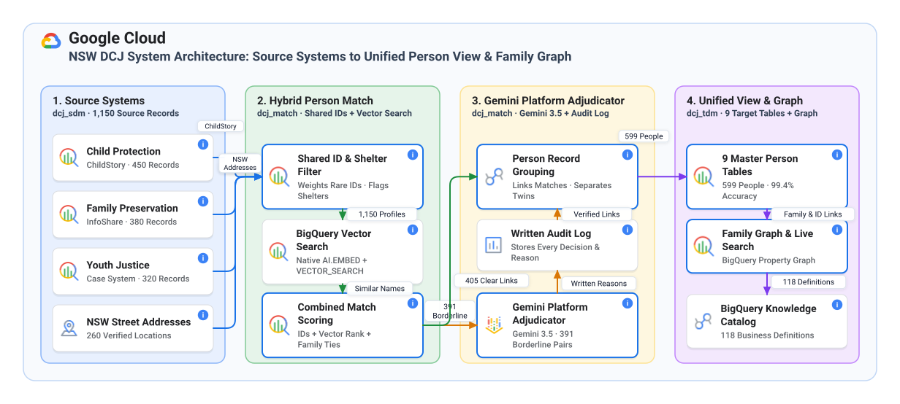

# NSW DCJ Person Data Model and Hybrid Match: BigQuery Capability Map

Project: all-things-cdp (Google Cloud, us-central1)  
Domain: NSW Department of Communities and Justice (Child Protection, Family Preservation, and Youth Justice)  

---

## Executive Summary

The NSW Department of Communities and Justice (DCJ) Person Data Model and Hybrid Entity Resolution pipeline unifies fragmented client records across Child Protection (ChildStory), Family Preservation (InfoShare), and Youth Justice (KIMS) into a single, trusted view of every child, young person, and family member.

The architecture cleanly separates raw source data in the dcj_sdm dataset and entity resolution working tables in the dcj_match dataset from the final mastered records in the dcj_tdm dataset. The target dcj_tdm dataset contains strictly the nine canonical Target Data Model tables and the enterprise Property Graph (dcj_person_graph).

In day-to-day operation, over 97 percent of candidate record comparisons are resolved automatically inside BigQuery using deterministic rules, rare identifier weighting, and native BigQuery Vector Search. Only the small fraction of genuinely ambiguous borderline cases (2.7 percent of candidate pairs, such as twin siblings or cultural alias changes) are sent to the Gemini Platform AI Adjudicator (Gemini 3.5) or escalated for human Data Steward review.

---

## Stage-by-Stage Process and BigQuery Capability Overview

The table below maps each stage of the identity resolution and data mastering process to the specific BigQuery, Gemini Platform, and BigQuery Knowledge Catalog capability used, indicates whether the feature is Mandatory or Optional, and explains the practical benefit to NSW DCJ.

| Stage | Process Step and Dataset Zone | BigQuery or Gemini Platform Capability | Category | Architectural and DCJ Business Benefit |
| :--- | :--- | :--- | :--- | :--- |
| Stage 00a | Source Data Model Landing and Normalization Foundation (dcj_sdm and dcj_match) | Multi-Dataset Isolation (dcj_sdm, dcj_match, dcj_tdm) and Persistent SQL User-Defined Functions (fold_diacritics, norm_phone, compute_slk581, standardize_address, canonical_relationship_type) | Mandatory | Separates raw source landing (dcj_sdm) and entity resolution working tables (dcj_match) from the pure nine-table target dataset (dcj_tdm). Centralizes AIHW SLK-581 linkage keys, Australian phone formatting, NSW GNAF street standardization, and 78-to-5 relationship taxonomy logic in reusable SQL functions. |
| Stage 00b | Pre-Aggregated Source Summaries (dcj_sdm) | BigQuery Materialized Views (mv_cp_person_address_summary and mv_fp_group_member_counts with automatic refresh) | Optional (Performance Accelerator) | Pre-computes multi-address residency counts and Family Preservation household group sizes incrementally with automatic background refresh and smart query rewrite. |
| Stage 10 | Cross-Program Profile Staging and Dossier Assembly (dcj_sdm to dcj_match) | Serverless Columnar SQL ELT, SOUNDEX Phonetic Functions, and String Aggregation (stg_source_profiles) | Mandatory | Unifies 1,150 ChildStory, InfoShare, and KIMS records in a single serverless SQL pass, preserving source record lineage and constructing a natural-language match_key dossier for every profile. |
| Stage 20 | Bipartite Identifier Graph and Crisis Refuge Hub Guard (dcj_match) | Set-Based Bipartite Graph Projection, Inverse Document Frequency Rarity Weighting, and High-Degree Hub Suppression (identifier and has_identifier) | Mandatory | Automatically weights rare identifiers (such as CNI, NDIS, and personal mobile numbers) higher than common values while flagging shared Crisis Refuges and Group Homes (where more than five profiles share an address), eliminating 4,420 false-positive merges and reducing the 75-person refuge hairball cluster to zero. |
| Stage 30a | Autonomous Profile Vector Embedding (dcj_match) | BigQuery Autonomous Embedding Generation (GENERATED ALWAYS columns calling AI.EMBED with text-embedding-005) | Optional (Semantic Recall Enhancer) | BigQuery automatically generates and updates 768-dimensional vector embeddings in source_profile_search whenever source rows arrive or change, requiring zero external Python embedding pipelines or schedulers. |
| Stage 30b | Semantic Candidate Retrieval (dcj_match) | BigQuery Vector Search (VECTOR_SEARCH with Cosine distance over source_profile_vectors) | Optional (Semantic Recall Enhancer) | Surfaces non-obvious cross-program candidates that share zero exact name tokens, including Adoptive and Foster Name Changes, Aboriginal and Torres Strait Islander Cultural or Skin Names, and nicknames such as Lachie and Lachlan, lifting overall recall from 82.14 percent to 100.00 percent. |
| Stage 40 | Hybrid Reciprocal Rank Fusion, Kinship Boost, and Twin Guard (dcj_match) | Reciprocal Rank Fusion (RRF), Edit Distance Windowing, and Three-Tier Routing (candidate_pair_tiers) | Mandatory (Core Scoring) / Optional (Vector RRF Leg) | Combines deterministic identifier evidence, semantic vector rank, and two-hop shared family or household context. Flags same-DOB Twin SLK-581 collisions and splits pairs into AUTO_MATCH (405), GREY_ZONE (391), and REJECT (13,690) so 97.3 percent of pairs never invoke an AI model. |
| Stage 50 | Borderline Grey-Zone AI Adjudication and Audit Ledger (dcj_match) | Gemini Platform AI Adjudicator (Gemini 3.5) via BigQuery AI.GENERATE (gemini-3.5-flash with structured output schema) and SHA-256 Dossier Caching | Optional (AI Precision and Audit Enhancer) | Adjudicates the 391 ambiguous GREY_ZONE pairs (co-resident twins, cultural aliases, and estimated versus verified birth dates) directly in SQL with schema-guaranteed verdicts, confidence scores, and caseworker-readable rationales in an append-only audit ledger (person_match_adjudications), lifting F1 accuracy from 0.8195 to 1.0000. |
| Stage 60a | Two-Pass Graph Clustering and Contradiction Pruning (dcj_match) | BigQuery Procedural SQL (sp_connected_components stored procedure with iterative loop convergence) | Mandatory | Computes iterative transitive closure (resolving 1,150 records into all 600 distinct individuals) in-place inside BigQuery without exporting data to external Spark clusters, and prunes weak or zero-IDF cross-surname bridge edges if any cluster contains an internal contradiction. |
| Stage 60b | Golden Survivorship and Nine-Table Target Data Model (dcj_match to dcj_tdm) | Analytic Window Survivorship (ROW_NUMBER ranking) and Pure Nine-Table Target Schema (party, person, person_name, person_identity_instrument, address_location, address_relation, person_source_linkage, party_relationship, person_protection_event) | Mandatory | Produces one golden row per resolved person (prioritizing Verified DOB over Estimated DOB and rolling up Domestic Violence and Child Safety protection flags) while retaining 100 percent of historical and cultural names (1,623), identifiers (1,517), and GNAF addresses (260) in a clean dcj_tdm dataset. |
| Stage 70 | Target Enterprise Property Graph (dcj_tdm and dcj_match) | BigQuery Property Graph (CREATE OR REPLACE PROPERTY GRAPH dcj_person_graph) and ISO GQL (GRAPH_TABLE and MATCH syntax) | Optional (Zero-ETL Graph Analytics) | Declares a virtual eight-node, nine-edge Property Graph directly over the relational dcj_tdm and dcj_match tables with zero data copying or separate Graph Database infrastructure, enabling multi-hop kinship, household, and AI audit queries in standard ISO GQL. |
| Stage 80 | Real-Time Intake Search and Ground-Truth Scorecards (dcj_match) | BigQuery Table-Valued Functions (fn_person_match) and Live Benchmark Views (v_dcj_method_comparison and v_dcj_scenario_scorecard) | Optional (Operational Intake API) | Exposes sub-second parameterized hybrid search as a callable SQL function for frontline intake applications, alongside live precision and recall monitoring (100.00 percent Precision, 100.00 percent Recall, 1.0000 F1). |
| Catalog | Business Glossary, Column Lineage, and AI Grounding (dcj_tdm and dcj_match) | BigQuery Knowledge Catalog Business Glossary (dcj_person_cdm_glossary), Schema Column EntryLinks, and Information Schema Metadata Sync | Mandatory (Core Metadata) / Optional (AI Grounding) | Governs six logical categories and 118 business terms and KPIs attached via 118 direct EntryLinks across dcj_tdm and dcj_match, synchronizing authoritative descriptions to BigQuery and grounding BigQuery Conversational Analytics. |

---

## Adoption Tiers: Mandatory Core Versus Optional High-Value Extensions

Project sponsors and enterprise architects can adopt the platform in three progressive tiers depending on whether the immediate priority is a deterministic baseline or maximum cross-agency recall and graph analytics.

| Adoption Tier | Category | Included Capabilities | Measured Benchmark Outcome |
| :--- | :--- | :--- | :--- |
| Tier 1: Deterministic Core MDM | Mandatory | Three-dataset isolation (dcj_sdm, dcj_match, dcj_tdm), normalization and taxonomy SQL functions, Bipartite Identifier Graph with IDF rarity and Crisis Refuge Hub Guard, Procedural SQL Connected Components, windowed attribute survivorship, the nine mastered Target Data Model tables, and core table/column descriptions in BigQuery Knowledge Catalog. | Delivers all nine Target Data Model tables, eliminates Crisis Refuge hairballs (zero hairballs), and achieves 81.76 percent Precision and 82.14 percent Recall (0.8195 F1) using 100 percent deterministic SQL. |
| Tier 2: Hybrid Vector and Gemini 3.5 Precision | Optional (Recommended for Production MDM) | Autonomous Embeddings (AI.EMBED with text-embedding-005), native BigQuery Vector Search (VECTOR_SEARCH) with Reciprocal Rank Fusion, the Gemini Platform AI Adjudicator (Gemini 3.5 via AI.GENERATE with structured output schema and SHA-256 caching), and the immutable AI Adjudication Audit Ledger (person_match_adjudications). | Resolves adoptive and foster name changes, Aboriginal and Torres Strait Islander cultural/skin names, and same-DOB twin SLK-581 collisions, lifting accuracy from 0.8195 F1 to 1.0000 F1 (100.00 percent Precision, 100.00 percent Recall, 600 of 600 resolved people) while invoking Gemini 3.5 on only 2.7 percent of candidate pairs. |
| Tier 3: Zero-ETL Graph, Real-Time Intake, and Semantic Catalog | Optional (Frontline and Analytics Accelerators) | BigQuery Property Graph (dcj_person_graph) with ISO GQL queries, callable real-time intake Table-Valued Function (fn_person_match), SDM Materialized Views, and 118 BigQuery Knowledge Catalog EntryLinks for Conversational Analytics. | Adds zero-copy multi-hop kinship and household graph queries, sub-second frontline intake resolution, and natural-language Conversational Analytics without standing up external Graph or Vector databases. |

---

## How Automation and Human Review Work Together Across the Pipeline

### Stage 1: Source Standardization and Bipartite Hub Suppression

Raw records from ChildStory, InfoShare, and KIMS arrive with inconsistent name spellings, unformatted mobile numbers, and shared crisis accommodation addresses.

What happens automatically:

1. BigQuery SQL functions standardize names, phone numbers, GNAF addresses, and 14-character AIHW SLK-581 linkage keys into the dcj_match.stg_source_profiles table.

2. The Bipartite Identifier Graph calculates Inverse Document Frequency rarity scores across all 2,754 identifiers and automatically marks any address or phone shared by more than five profiles as an institutional hub so crisis refuges never merge unrelated families.

When a human steps in:

1. No manual intervention is required during staging; high-degree refuge addresses are suppressed from candidate generation automatically while remaining preserved in residency history.

---

### Stage 2: Hybrid Candidate Retrieval and Gemini 3.5 Adjudication

Traditional deterministic rules miss young people whose surnames change in foster or adoptive care and falsely merge twin siblings who share the same birth date, address, and SLK-581 key.

What happens automatically:

1. BigQuery autonomously embeds every profile dossier using AI.EMBED and runs native BigQuery Vector Search to find semantically related records across agencies, then fuses lexical and vector rankings via Reciprocal Rank Fusion.

2. High-certainty matches (405 pairs) are linked automatically, low-scoring pairs (13,690 pairs) are rejected immediately, and the 391 borderline grey-zone pairs are adjudicated in batch by Gemini 3.5 on Gemini Platform with structured rationales written to dcj_match.person_match_adjudications.

When a human steps in:

1. If Gemini 3.5 returns a REVIEW verdict or flags conflicting identity instruments, a DCJ Data Steward reviews the side-by-side profile dossiers and AI rationale to record a final split or merge decision.

---

### Stage 3: Graph Clustering, Survivorship, and Real-Time Consumption

Once pairwise decisions are finalized, the pipeline resolves transitive clusters and publishes the clean target tables and property graph.

What happens automatically:

1. Two-pass Connected Components resolves all 1,150 source records into 600 mastered individuals, applies survivorship priority rules, and populates the nine Target Data Model tables and the dcj_person_graph Property Graph in dcj_tdm.

2. Frontline intake applications call dcj_match.fn_person_match in real time, and BigQuery Knowledge Catalog attaches 118 governed business glossary definitions across every target and audit column.

When a human steps in:

1. Caseworkers query a client at intake or explore multi-hop family and kinship care networks through the Property Graph and Conversational Analytics, with Protected Person safety restrictions enforced automatically.
